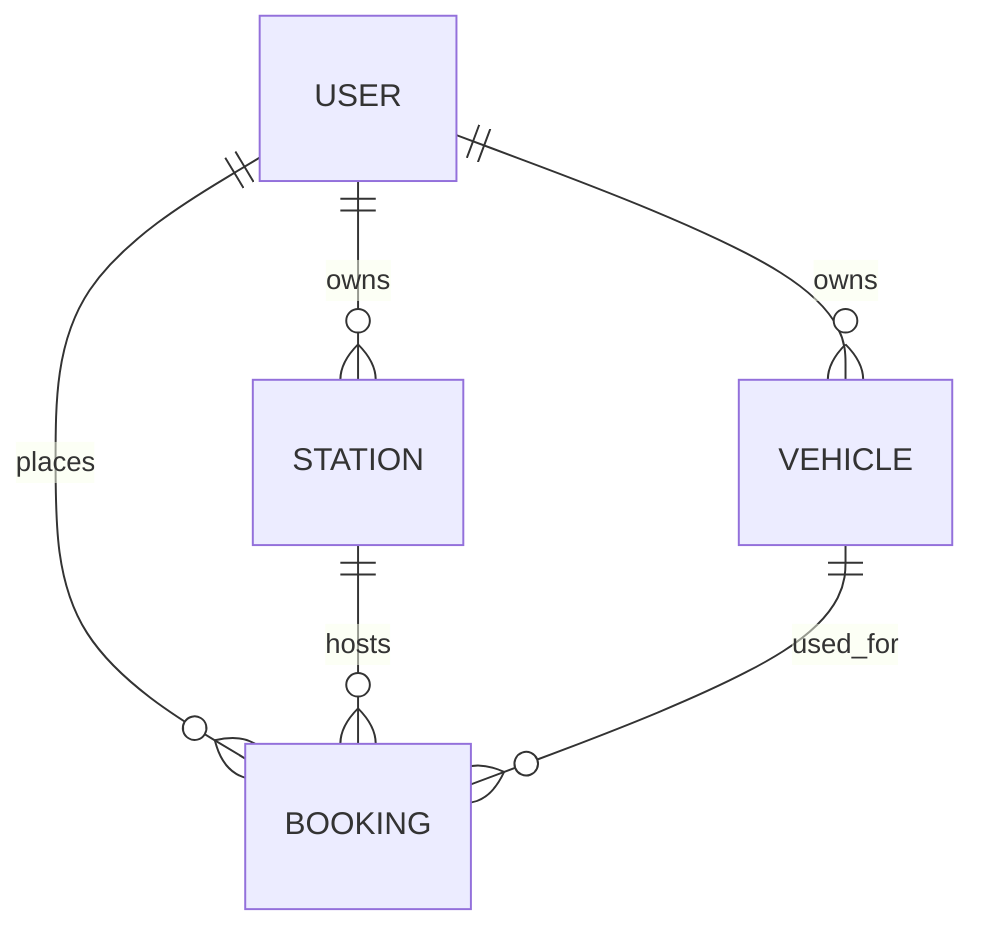

# SQL / ER diagram → MERN implementation

| Entity | Source fields | MongoDB representation |
|---|---|---|
| Users | user_id, name, membership | User collection; numeric display ID, membership enum |
| Stations | station_id, name, address, supported_plug, current_status, user_id | Station collection; owner references User |
| Vehicles | vehicle_id, user_id, model_name, plug_type | Vehicle collection; owner references User |
| Bookings | booking_id, user_id, station_id, vehicle_id, start_time, end_time, energy_used_kwh, total_bill | Booking collection; references User, Station, Vehicle; dates and nonnegative numeric amounts |

Mongoose adds `_id`, `createdAt`, and `updatedAt`. Booking adds `status` and a seed-only `legacy_import` flag. Display IDs use transaction-protected counters, preserving auto-increment semantics. IDs are never reused after deletion.

## Relationships

## Query and trigger equivalents

| SQL feature | Application equivalent |
|---|---|
| Primary keys / AUTO_INCREMENT | MongoDB `_id` + unique numeric ID and atomic Counter |
| Foreign keys | Required ObjectId references validated by Express inside a transaction |
| ON DELETE CASCADE | Transactional deletion of linked vehicles, stations and bookings |
| `check_plug_compatibility` | Booking service rejects unmatched station and vehicle plugs |
| `mark_station_occupied` | Reserved or Charging booking sets station to Occupied |
| `mark_station_available` | Completion, cancellation, move or deletion releases the station when no active booking remains |
| `View_BookingDetails` / joined history | Mongoose populate of the user, vehicle and station; Bookings UI |
| `View_AvailableStations` | Filtered station query and Available tab |
| `View_UserBillingSummary` | MongoDB `$lookup`, `$size`, `$sum`, including users with zero bookings |
| User spending ranking | User billing aggregation sorted by total spent |
| Membership update using HAVING count >= 2 | Idempotent “Upgrade eligible members” action |
| 10% Basic member billing discount | Seeded final SQL amounts; suggested bill for newly created Basic member bookings |
| Compatibility CASE expression | Legacy marker for historical mismatches; matching plug constraint for new bookings |
| Station revenue grouping | MongoDB aggregation in Insights |

Extra integrity checks: vehicle ownership, end after start, nonnegative energy and amounts, valid enum values, referential existence, maintenance exclusion and one active reservation per vehicle/station. Station and vehicle edits cannot invalidate active bookings. Writes are serialized through one transaction lock for this mini-project; larger systems should use scoped resource locks and appropriate indexes.

MongoDB is accessed only by the Express backend. React sends JSON over same-origin `/api` endpoints. React never receives the MongoDB URI.
